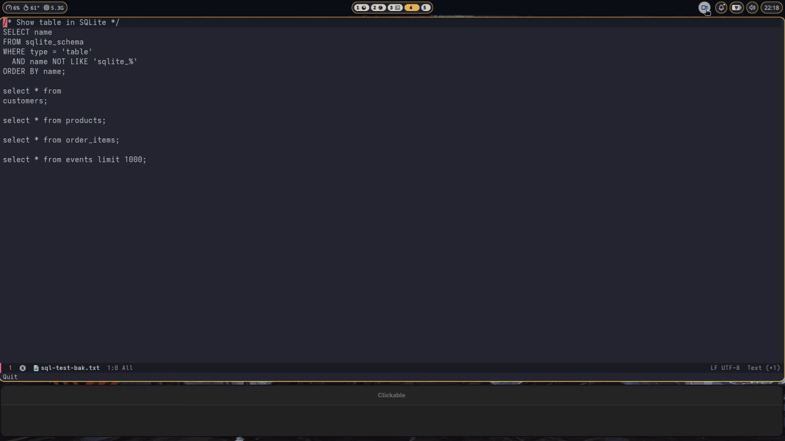

# sql-grid



> [!WARNING]
> This extension was written with the help of a coding agent.

`sql-grid` is a standalone Emacs package for executing SQL against SQLite, MySQL, MariaDB, and PostgreSQL and viewing query results as native-text graphical grids or aligned text tables.

## Requirements and installation

Requires Emacs 29.1 or newer. SQLite uses Emacs's native `sqlite` interface (and therefore requires an Emacs build with native SQLite support). The default `grid` view requires graphical Emacs; text tables also work in terminal Emacs. Neither view requires SVG-image support, a patched image library, or other system changes.

The graphical grid uses the same native Emacs text shaping and fontsets as the cell inspector. By default, `sql-grid-grid-font-family` is `nil`, so Emacs font and fontset settings apply. Set it to a plain Emacs font family name to choose a family for grid cells; the font must be installed and have glyph coverage for displayed characters. For Khmer, an installed font such as Noto Sans Khmer can render Khmer text:

```elisp
(setq sql-grid-grid-font-family "Noto Sans Khmer")
```

This option takes one family name, not a CSS fallback list. After changing font settings, press `g` in existing result buffers to refresh retained results without rerunning SQL.

SQLite needs an Emacs build with native SQLite support and access to its database file. Emacs needs read access to an existing database and write access for changes; creating a database also requires write access to its parent directory. The filename may be `:memory:` for a temporary database.

MySQL and MariaDB need their external command-line clients (`mysql` and `mariadb`, respectively); installing a client does not install or start a database server. Emacs must find the selected executable through its `exec-path`/`PATH`. To select non-default executable paths, set:

```elisp
(setq sql-grid-mysql-program "/usr/bin/mysql"
      sql-grid-mariadb-program "/usr/bin/mariadb"
      sql-grid-postgres-program "/usr/bin/psql")
```

For Fedora, install the MariaDB client with `sudo dnf install mariadb`. This installs the client, not a running server. If Emacs cannot find a client, check its `exec-path` and `PATH`; GUI Emacs may not inherit shell environment settings. Update Emacs's environment or restart Emacs after changing it. The error `Database client executable not found: mariadb` occurs before any network connection or authentication attempt.

For MySQL and MariaDB, connect to either a running local server or a reachable remote server. Provide its database, host, port, and user, plus a password the account accepts (which may be empty). The account must be allowed to connect from Emacs's host and access that database. The host defaults to `localhost`, and an empty port uses the client default. `sql-grid` exposes no socket-path setting; when using a local socket, the client uses its own defaults.

PostgreSQL requires `psql` 12 or newer for CSV output; its executable must also be available through Emacs's `exec-path`/`PATH`.
Connect to a running local or reachable remote PostgreSQL server. Provide its database and set host, port, and user as needed; omitted user and port use client defaults. Authentication must accept the configured or prompted password. The account must be allowed to connect from Emacs's host and access that database. The host defaults to `localhost`.

Add `sql-grid/` to `load-path` only if Emacs cannot already find the package: `(locate-library "sql-grid")` returns `nil`. Skip the `add-to-list` line if your package manager or existing configuration already makes the package available:

```elisp
;; Only needed when Emacs cannot already locate sql-grid.
(add-to-list 'load-path "/path/to/sql-grid")
(require 'sql-grid)
```

Run `M-x sql-grid-connect` to open a dedicated SQL editor, or run `M-x sql-grid-connect-buffer` to connect the current buffer. If named profiles are configured, select one or submit an empty choice for manual settings. Otherwise, choose the engine and answer the prompts. SQLite accepts a filename or `:memory:`. Manual server connections prompt for database, host, port, user, and password; an empty port selects the client default. Server profiles without a configured password prompt only for the password. Passwords entered interactively are prompted without echo, and the interactive UI clears them on disconnect, buffer kill, or major-mode change. MySQL and MariaDB write credentials to a temporary mode-0600 client options file; PostgreSQL writes a temporary mode-0600 libpq password file. Each file is removed after its invocation.

## Named connections

Set `sql-grid-connections` in your Emacs configuration, after loading the package:

```elisp
      '(("Local SQLite"
         :backend sqlite
         :database "~/data/app.sqlite")
        ("Development MySQL"
         :backend mysql
         :database "app_dev"
         :host "127.0.0.1"
         :port 3306
         :user "developer")
        ("Development PostgreSQL"
         :backend postgres
         :database "app_dev"
         :host "127.0.0.1"
         :port 5432
         :user "developer"
         :password "example-password")
        ("Reports MariaDB"
         :backend mariadb
         :database "reports"
         :host "db.example.com"
         :user "reader")))
```

Each profile has a unique, nonempty string name and a property list. `:backend` and `:database` are required; supported backends are the symbols `sqlite`, `mysql`, `mariadb`, and `postgres`. PostgreSQL `:database` values are database names, not connection URIs or conninfo strings. Server profiles can also set `:host`, `:port` (an integer), `:user`, and optional `:password` (a string). An omitted host defaults to `"localhost"`; omitted port and user use the client defaults. SQLite profiles only use `:backend` and `:database`; server password settings are ignored for SQLite.

Both connection commands offer these names through minibuffer completion. Submit an empty choice at `Connection (RET for manual settings):` to enter settings manually. Setting `sql-grid-connections` to `nil` restores the original prompts without the profile-selection step. You can also edit profiles through `M-x customize-option RET sql-grid-connections`.

An omitted or `nil` server-profile `:password` prompts securely during connection. A string, including `""`, uses that password without prompting. Configured passwords are stored in cleartext in your Emacs configuration and remain there until you remove them; use this option only if that storage is acceptable. Selecting a profile creates a fresh connection owned by the source buffer, not a shared session. Multiple buffers can select the same profile independently; disconnecting one clears only its connection password, not other buffers or the saved profile.

## Commands

- `M-x sql-grid-connect` opens a connected SQL editor in `sql-grid-mode`, derived from `sql-mode`.
- `M-x sql-grid-connect-buffer` connects the current buffer and automatically enables `sql-grid-mode`, preserving its text and cursor position. This replaces its previous major mode and mode-specific keybindings. Disconnect before connecting that buffer to another database.
- `C-c C-c` (`M-x sql-grid-execute-statement`) starts the blank-line-separated SQL block containing point, including continuation lines, without blocking Emacs, and ignores any active region.
- `C-c C-r` (`M-x sql-grid-execute-region`) starts the selected region without blocking Emacs.
- `C-c C-k` (`M-x sql-grid-cancel`) cancels the running query from the source editor or its result buffer. Read the cancellation warnings above before using it.
- `C-c C-s` (`M-x sql-grid-browse-schema`) opens the read-only schema browser for this editor. `M-x sql-grid-refresh-schema` refreshes cached schema from the SQL editor.
- `M-TAB` or `C-M-i` (`completion-at-point`) completes cached table and column names. See [Schema browsing and completion](#schema-browsing-and-completion).
- `C-c C-d` (`M-x sql-grid-disconnect`) disconnects the current buffer. Existing buffers stay open in `sql-grid-mode`; dedicated SQL editors close.
- In result buffers, hover a cell for its full value (`sql-grid-show-cell-tooltips` controls tooltips; after changing it, press `g` to rerender); click a cell or navigate with `TAB`/`<backtab>` and press `RET` or graphical `Return` to inspect its full original value, including line breaks. This only inspects retained results and never reruns SQL. `M-w` copies the selected cell's full original value; Evil users can press `y`. `g` rerenders retained results, `c` copies a selected row, `C` copies a selected column, `e` exports current filtered results as CSV, and `q` closes the result view.
- `M-f` (`M-x sql-grid-next-cell`) moves to the next result cell, just like `TAB`, including in Evil normal state. Each press moves exactly one cell, regardless of word count, punctuation, or an empty value. Moving past a row's last cell selects the next row's first cell.
- Standard `C-s` / `C-r` searches full cell values, including text hidden by truncation. Regexp search (`C-M-s` / `C-M-r`) uses the same full text. Press `RET` to finish searching, then `RET` again to inspect the matched cell.
- In graphical grid results, `<right>` / `<left>` and `C-f` / `C-b` move between cells. `<down>` / `<up>` and `C-n` / `C-p` move to the adjacent visible row in the same column, including after a search ends inside truncated text. Evil normal state also uses `h` / `l` for cells and `j` / `k` for rows in grid results. Text tables keep native character and line motion.
- In result buffers, `s` sorts the column at point, or prompts for a column when point is outside a result cell. Repeated sorting of the same column toggles ascending and descending; `C-u s` restores original query row order. Click or press `RET` on a header to sort too.
- When a result row limit is set, `]` (`M-x sql-grid-next-page`) and `[` (`M-x sql-grid-previous-page`) move between pages of the result set under point.
- `C-c C-f` filters retained rows, `C-c C-v` changes result format, and `C-c C-l` changes the current result buffer's maximum rows per page. These native bindings also work alongside Evil without replacing `/` search.

For SQL inside an existing SQL file, Org document, or other buffer, run `M-x sql-grid-connect-buffer` to switch to `sql-grid-mode`, select only the SQL statement, then press `C-c C-r`. Do not include Org source-block markers, Markdown fences, or surrounding prose. Each connected source buffer owns its connection; other buffers do not inherit it. Killing the source buffer or changing its major mode closes the connection. Both connection commands provide the same execution keys and SQL syntax highlighting. Enabling `sql-grid-mode` alone does not open a connection.

Place point inside a SQL block and run `M-x sql-grid-execute-statement`. Blank lines separate blocks; lines containing only spaces or tabs also count as separators. The command selects contiguous nonblank lines around point, without inspecting SQL keywords or using semicolons to choose boundaries. A blank line under point executes nothing. Keep one SQL statement per block; a trailing semicolon is optional. Notes or file paths in other blocks are not included. For SQL containing intentional blank lines, including inside strings or comments, select the complete statement and use `M-x sql-grid-execute-region` instead.

Results appear without echoing the submitted SQL above the grid. By default, execution selects the result window. To display results while keeping the selected source window and cursor position:

```elisp
(setq sql-grid-focus-results nil)
```

Set `sql-grid-focus-results` to `t` to switch to results after execution. This preference also applies to programmatic result display. Refreshing an already selected result buffer keeps that window selected.

## Schema browsing and completion

`C-c C-s` (`sql-grid-browse-schema`) opens a read-only schema browser owned by the current SQL editor. The browser lists tables and views with their schema-qualified names, columns and declared types, nullability, primary keys, defaults, hidden SQLite columns, indexes with ordered columns and uniqueness, partial-index predicates (or a `PARTIAL` marker when a predicate is unavailable), and foreign-key targets. SQLite discovery includes attached databases. MySQL and MariaDB discovery covers the current database only; other databases on the server are not listed. PostgreSQL discovery covers non-system schemas in the current database. Rendering the browser uses only cached schema and does not execute SQL.
Each backend adapter owns its schema queries and normalizes tables, columns, indexes, and foreign-key parts into metadata shared by the browser and completion; the schema coordinator manages asynchronous discovery. MySQL and MariaDB use one shared implementation. Backend modules are `sql-grid-db-sqlite.el`, `sql-grid-db-mysql.el` (MySQL and MariaDB), and `sql-grid-db-postgres.el`; `sql-grid-db.el` provides public dispatch and connection lifecycle, `sql-grid-db-core.el` supplies shared helpers, and `sql-grid-db-worker.el` is the SQLite worker entry point.

Schema discovery runs asynchronously on the editor's connection. Press `g` in the browser, or run `M-x sql-grid-refresh-schema` in the SQL editor, after DDL to refresh the cache. Completion also requests discovery when the cache has not loaded yet, but it returns no candidates until that request finishes; repeat `M-TAB` or `C-M-i` after the cache loads. A failed discovery reports its error in the browser and suppresses further automatic completion attempts; press `g` in the browser or run `M-x sql-grid-refresh-schema` to retry. Each editor has its own cache and browser; disconnecting clears the cache and leaves an open browser showing the editor as disconnected.

`M-TAB` or `C-M-i` (`completion-at-point`) completes cached table and column names without querying the database. It supports unqualified names, `table.column`, and `schema.table.column` qualification, matches ASCII names case-insensitively, and leaves non-ASCII case distinct on SQLite. PostgreSQL completion quotes mixed-case and otherwise unsafe identifiers with double quotes and respects schema-qualified names. Completion replaces the current identifier suffix, including a closing quote when present, and does not run inside strings or comments. It is not aware of query scope or table aliases, so it offers names from the whole cached schema rather than only names visible at point.

## Select and copy multiple cells

In a result buffer, place point on the first cell, press `C-SPC`, move to
the opposite corner, then press `M-w`. In grid view, arrows and
`C-f`/`C-b`/`C-n`/`C-p` move by cell; shifted arrows can start and extend
the selection. `TAB` and `<backtab>` move between cells in either view.
Evil users can use `v` or `C-v`, cell motions, and `y`; `V` selects complete
rows. `M-x sql-grid-copy-selection` copies an active selection explicitly.

Selection includes both endpoint cells and follows the currently displayed
row and column order, including sorting, filtering, and column moves.
Native and Evil character/block selections form a cell rectangle; Evil
linewise selection includes every column. Endpoints must belong to one
displayed result set. Selected cells are highlighted without selecting grid
separators.

Copying produces plain text: tabs between columns and newlines between rows,
without borders, padding, sort indicators, or text properties. Copies use
full original scalar values, not truncated labels. Embedded tabs and newlines
remain unchanged; use CSV export when delimiters inside values need quoting.
SQL NULL copies as `NULL`; an empty string copies as an empty field. Without
an active selection, `M-w` and `y` still copy the current cell.

## Customize native result bindings

Result buffers use `sql-grid-result-mode`, derived from `special-mode`.
Set defaults in its persistent keymap:

```elisp
(with-eval-after-load 'sql-grid
  (define-key sql-grid-result-mode-map (kbd "C-c /") #'sql-grid-filter-rows)
  (define-key sql-grid-result-mode-map (kbd "C-c v") #'sql-grid-set-result-format))
```

For buffer-specific bindings, copy the map in `sql-grid-result-mode-hook`
before calling `local-set-key`. Refresh and format changes do not recreate
the map or overwrite user bindings. Native text views retain character and
line movement; grid views use cell movement.

## Freeze column names

Column names scroll with the result rows by default. To keep them fixed
above the rows, enable:

```elisp
(setq sql-grid-freeze-column-names t)
```

## Result row limit and pagination

`sql-grid-max-rows` controls rows displayed per page, defaulting to `1000`.
A positive integer enables pagination. Set it to `nil` to display all returned
rows together, without pagination:

```elisp
(setq sql-grid-max-rows 100) ; show up to 100 rows per page
;; Or:
(setq sql-grid-max-rows nil) ; show all rows without pagination
```

The limit controls display only. SQLite, MySQL, MariaDB, and PostgreSQL retain every row
returned by the submitted statement, so later pages remain accessible. For
example, 250 returned rows with a limit of 100 produce three pages: 100, 100,
and 50 rows. An explicit SQL `LIMIT` still bounds what the query returns; the
package does not rewrite SQL or set a server `sql_select_limit`.

Press `]` (`sql-grid-next-page`) for the next page or `[`
(`sql-grid-previous-page`) for the previous page. These keys also work in Evil
normal state. Each result set shows its page number, displayed row range, and
total matching rows. Navigation stops at the first and last pages without
wrapping. With multiple result sets, place point in the desired set; outside
all sets, navigation uses the first one. Each set and result buffer keeps its
own page position.

Pagination works in grid and text views. Refresh, zoom, column moves, and format
changes preserve the current page. Sorting resets the current set to page one;
filtering resets all sets to page one. A new execution or call to
`sql-grid-display-results` resets pages and captures current
`sql-grid-max-rows`, unless this result buffer has a temporary override.
Changing the global setting does not affect existing results.

Press `C-c C-l` (`M-x sql-grid-set-max-rows`) to enter a positive page size
or `all` for no pagination. Programmatically, pass a positive integer or
`nil`. This changes only the current result buffer, resets every set to page
one, and rerenders retained data without executing SQL. The override survives
refresh, format changes, and subsequent executions from the same source.
Other buffers and the configured `sql-grid-max-rows` remain unchanged.

Filtering searches all retained rows before pagination and resets every set to
its first page. Cell inspection, incremental search, and row/column copying use
only the displayed page, preserving original row identities and full values.
Clear the filter to return to the first page of all retained rows.

Page navigation never executes SQL again or changes its `LIMIT`. All returned
rows remain in memory; pagination bounds rendering, not retrieval or memory use.

## Filter result rows

Press `C-c C-f` or `/` (`M-x sql-grid-filter-rows`) in a result buffer and enter
an Emacs regular expression. A row stays visible when any cell's full original value
matches, ignoring case. For example, `New York` finds that text anywhere in a
cell, and `^NULL$` matches the displayed SQL NULL spelling as well as a literal
`"NULL"` string. Empty strings remain distinct retained values.

Filtering includes text hidden by truncation and original line breaks. It
applies to every result set in the current buffer, in grid and text views.
Copying uses visible rows, full original values, and current column order.

Enter an empty filter to restore all retained rows. Refresh, zoom, format
changes, sorting, and column moves keep the filter; a new execution or call to
`sql-grid-display-results` clears it. Filtering cannot recover rows omitted
by the submitted query, including an explicit SQL `LIMIT`. Other result buffers
keep their own filters.

## Sorting

Press `s` on a header or value, or click or press `RET` on a header, to set
the primary sort. Repeating `s` on that column toggles direction; choosing
another column replaces the sort. Outside a cell, choose a column from the
prompt. Use `C-u s` to clear every sort key and restore query row order.

Press `S` (`sql-grid-add-sort-column`) to append another sort key. For example,
press `s` on status, then `S` on date to sort by status first and date second.
Repeating `S` on an active key toggles its direction without changing priority.
Headers show numbered indicators such as `↑1` and `↓2`.

Sorting applies stably to retained, filtered rows before pagination. Equal
values in every key keep their original query order. Ascending order is SQL
NULL, numeric values, then text; descending reverses these categories.
Numbers compare numerically. Text values, including strings returned by the
backend, compare lexically and case-sensitively and are never coerced to
numbers. Sorting never changes retained data or reruns SQL; a new
execution or call to `sql-grid-display-results` clears sorting.
Grid row backgrounds alternate by visible position after sorting and
filtering; retained row identities still identify the original scalar values.

The top status bar shows current result set, total retained rows, matching
rows, active filter, and current page and displayed row range.

## CSV export

Run `e` or `M-x sql-grid-export-csv` in a result buffer and choose a file.
Export includes every filtered row across all pages in the current result set,
using current visible column order and sort order. Export reads retained
values; it never reruns SQL.

The file uses UTF-8, comma separators, RFC 4180 quote escaping, and CRLF record
terminators. Fields containing commas, quotes, or line breaks are quoted, and
embedded quotes are doubled. SQL NULL exports as an unquoted empty field;
empty strings export as quoted empty fields. Text `"NULL"` follows ordinary
CSV quoting rules and is never treated as SQL NULL. Generic CSV readers can
lose the SQL NULL versus empty-string distinction.

## Column order

Place point on a header or value to reorder that column in the current result set:

| Key or command | Action |
| --- | --- |
| `M-<left>` or `M-h` (`sql-grid-move-column-left`) | Move the current column one position left. |
| `M-<right>` or `M-l` (`sql-grid-move-column-right`) | Move the current column one position right. |
| `m` (`sql-grid-move-column`) | Move the current column to a numbered position, starting at 1. |
| `M-x sql-grid-reset-column-order` | Restore the current result set's original SQL column order. |

Headers and all matching row values move together. Point stays on the same cell, and the result window scrolls horizontally when needed to reveal it. Moving past the first or last column reports a boundary error without wrapping. Outside a result cell, these commands report `Point is not on a result cell`.

Column order is local to each result set and result buffer. It survives `g`
refresh, text scaling, and format changes. Results with headers but no rows can
also be reordered; duplicate column names remain distinct.

Reordering never changes retained SQL results or executes SQL. A new execution
or call to `sql-grid-display-results` restores SQL column order. Row copying
uses visible column order. Row and column selection prompts follow visible
order and use the result set under point, or the first set when point is
outside a cell. Copying and inspection preserve full original values,
including the distinction between SQL NULL and empty strings.


## Result formats

| Format | View |
| --- | --- |
| `grid` | Native-text graphical grid; the default. |
| `text` | Aligned text table, suitable for graphical or terminal Emacs. |

Press `C-c C-v` or `f` in a result buffer to switch between `grid` and `text`. Each result
buffer keeps its own choice across refresh and subsequent executions from its
source buffer. Switching one result buffer does not change other buffers or the
global default. Both views keep cell inspection, full-value search, and
original-value row/column copying.

Use standard buffer text scaling (`C-x C-+`, `C-x C--`, and `C-x C-0`) to zoom results. Native text scales and grid geometry is recalculated to keep columns and interactive cells aligned. Zooming rerenders retained data without executing SQL again, preserves the selected cell, and survives refresh or view changes.

To start new result buffers in text mode, including when connecting from terminal Emacs:

```elisp
(setq sql-grid-result-format 'text) ; grid or text
```

Set this before connecting in a terminal. The graphical grid is unavailable there; trying to switch to it leaves the current view unchanged.

`sql-grid-max-cell-chars` controls displayed value length in grid and text
tables, including the truncation marker (default `80`). Configure a shorter
table limit or disable truncation:

```elisp
(setq sql-grid-max-cell-chars 40) ; nil means unlimited
```

Values longer than the limit are shortened to fit; exactly-at-limit values are unchanged. Any positive limit uses the one-character Unicode ellipsis (`…`) as the truncation marker, so the prefix may be empty or shorter than the available character budget to avoid ending before Unicode combining marks or immediately after canonical-class-9 linkers and joiners. This protects common combining sequences, including Khmer COENG, but is not complete Unicode grapheme-cluster segmentation. Truncation and newline normalization affect display only; row/column copy and cell inspection use original scalar values (`NULL` is shown as `NULL`). Empty strings remain empty and are distinct from SQL NULL.

Search operates on the full original cell text in every view, including original line breaks. It does not execute SQL again. After loading an updated package, press `g` in existing result buffers to rebuild their searchable text from retained results.

Evil's `/`, `?`, `n`, and `N` keep the matched cell selected in both its isearch
and Ex search engines, including matches inside truncated text. The grid focus
outline also follows active Ex-search previews while the minibuffer is open. Evil keeps
its `/` search binding; use `C-c C-f` or `M-x sql-grid-filter-rows` to filter.

Grid cells show focus with an inset outline in the theme's cursor color. The outline follows the cell inspected by `RET`, even when point is inside hidden full-value text or at the end of the last column. It does not move point, change search matches, or alter row and column geometry. Outside grid cells, Emacs uses the buffer's normal cursor.

To inspect cells in the minibuffer echo area without leaving the result window:

```elisp
(setq sql-grid-cell-display 'minibuffer)
```

Set `sql-grid-cell-display` to `'buffer` to restore the separate read-only buffer, or choose either value through `M-x customize-option RET sql-grid-cell-display`. The setting takes effect immediately for `RET` and mouse clicks in every result format; no refresh is needed. Both choices use full original values, not truncated display text. The echo area's visible space is limited by Emacs's `max-mini-window-height`; use the buffer option for values too large to view there. Empty strings clear the echo area, while SQL NULL displays `NULL`.

## Programmatic API

`sql-grid-display-results` takes a connection and retained result objects, renders them in the result buffer's chosen format (or `sql-grid-result-format` for a new buffer), and does not retain query text or execute SQL. Backend connection and execution functions are also available from `sql-grid-db`:

```elisp
(require 'sql-grid)
(let* ((connection (sql-grid-connection-create
                    :backend 'sqlite :database ":memory:")))
  (sql-grid-db-connect connection)
  (unwind-protect
      (sql-grid-display-results
       connection
       (sql-grid-db-execute connection
                             "SELECT 'hello' AS greeting, NULL AS missing"))
    (sql-grid-db-disconnect connection)))
```

MySQL:

```elisp
(let* ((connection (sql-grid-connection-create
                    :backend 'mysql :database "test" :host "127.0.0.1"
                    :port 3306 :user "app" :password "secret")))
  (sql-grid-db-connect connection)
  (unwind-protect
      (sql-grid-display-results
       connection
       (sql-grid-db-execute connection "SELECT VERSION() AS server_version"))
    (sql-grid-db-disconnect connection)))
```

MariaDB:

```elisp
(let* ((connection (sql-grid-connection-create
                    :backend 'mariadb :database "test" :host "127.0.0.1"
                    :port 3306 :user "app" :password "secret")))
  (sql-grid-db-connect connection)
  (unwind-protect
      (sql-grid-display-results
       connection
       (sql-grid-db-execute connection "SELECT VERSION() AS server_version"))
    (sql-grid-db-disconnect connection)))
```

These snippets use the public `sql-grid-connection-create`, `sql-grid-db-connect`, `sql-grid-db-execute`, `sql-grid-display-results`, and `sql-grid-db-disconnect` APIs. The synchronous execution functions return a list of `sql-grid-result` objects or signal an error. The literal server credentials are example values that must be replaced with credentials for an accessible server.

PostgreSQL:

```elisp
(let* ((connection (sql-grid-connection-create
                    :backend 'postgres :database "test" :host "127.0.0.1"
                    :port 5432 :user "app" :password "secret")))
  (sql-grid-db-connect connection)
  (unwind-protect
      (sql-grid-display-results
       connection
       (sql-grid-db-execute connection "SELECT version() AS server_version"))
    (sql-grid-db-disconnect connection)))
```

For nonblocking execution, use `sql-grid-db-execute-async`:

```elisp
(let ((connection (sql-grid-connection-create
                   :backend 'sqlite :database ":memory:")))
  (sql-grid-db-connect connection)
  (sql-grid-db-execute-async
   connection
   "SELECT 'hello' AS greeting"
   (apply-partially
    (lambda (connection results error-data)
      (unwind-protect
          (if error-data
              (message "SQL failed: %s" (error-message-string error-data))
            (sql-grid-display-results connection results))
        (sql-grid-db-disconnect connection)))
    connection)))
```

`sql-grid-db-execute-async` validates that SQL contains one statement, starts execution, and returns a job immediately. Its `CALLBACK` is required and, for a started job, runs exactly once with either a list of `sql-grid-result` objects and `nil` error data, or `nil` results and condition data. Completed results provide `sql-grid-result-elapsed` in seconds; writes may also provide an integer `sql-grid-result-affected-rows`, including zero, while an unknown affected count is `nil`. A `quit` condition such as `(quit "Query cancelled")` reports cancellation.

Cancel a running job with `sql-grid-db-cancel`. This example uses a temporary file-backed database because cancelling an in-memory job discards the entire database, and it removes the file afterward:

```elisp
(let* ((file (make-temp-file "sql-grid-cancel-" nil ".sqlite"))
       (connection (sql-grid-connection-create
                    :backend 'sqlite :database file)))
  (unwind-protect
      (progn
        (sql-grid-db-connect connection)
        (let ((job (sql-grid-db-execute-async
                    connection
                    "SELECT 1 AS ok"
                    (lambda (_results _error-data) nil))))
          ;; Cancel while running; this is a no-op after completion.
          (sql-grid-db-cancel job)))
    (ignore-errors (sql-grid-db-disconnect connection))
    (ignore-errors (delete-file file))))
```

`sql-grid-db-cancel` invokes a still-running callback once with a `quit` condition. It performs no confirmation, unlike interactive `sql-grid-cancel`. For SQLite it closes the worker connection, rolls back an uncommitted transaction, and invalidates the connection; other pending jobs on that connection fail, and no reconnect occurs automatically. Cancelling an in-memory SQLite job through this API therefore discards the entire database without prompting. For MySQL, MariaDB, and PostgreSQL it terminates that execution's client process only. After disconnect or SQLite cancellation, new queries are rejected until you explicitly reconnect with `sql-grid-db-connect`. While disconnect is settling pending callbacks, both new queries and reconnect attempts are rejected; callback errors are propagated only after cleanup and settlement of the other jobs.

## Tests

From the standalone package directory, batch ERT runs non-GUI tests and skips the GUI rendering tests:

```sh
emacs -Q --batch -L . -l sql-grid-test.el -f ert-run-tests-batch-and-exit
```

Run the GUI-capable ERT suite, including graphical grid rendering, in a graphical Emacs desktop session:

```sh
emacs -Q -L . -l sql-grid-test.el --eval '(let ((noninteractive t)) (ert-run-tests-batch-and-exit))'
```

Alternatively, if you have started an Xvfb-backed X11 server separately, run from the standalone package directory:

```sh
env -u WAYLAND_DISPLAY GDK_BACKEND=x11 DISPLAY="$DISPLAY" emacs -Q -L . -l sql-grid-test.el --eval '(let ((noninteractive t)) (ert-run-tests-batch-and-exit))'
```

